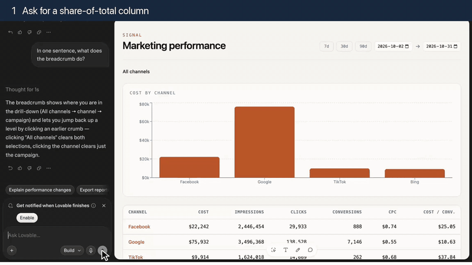

# product-feature-video

Record a web product doing real work in a real browser, then cut the takes into a short, branded feature showcase video.



*Made by the skill with no product knowledge: `probe.sh` wrote the profile, `scene.sh` recorded the ask, a 12-second reveal clicked two date ranges, `build.py` cut it. Storyboard in [`docs/demo.storyboard.json`](docs/demo.storyboard.json).* A [Pi](https://github.com/badlogic/pi-mono) skill: `SKILL.md` is the procedure, `scripts/` does the recording and cutting, `profiles/` describes how to drive a given product.

Built for chat and agent UIs: the user asks, the product proposes, an approval card appears, something gets created, you open it. One video is one customer story told in 3–7 of those beats.

## What it produces

A 1080p MP4 with an intro card, a chapter banner on every clip, a caption on the first approval ("Nothing changes until you approve"), a toast on every reveal, the brand logo and fonts, a synthetic cursor that glides to each click (tab recordings never include the pointer), waiting sped up 3–6×, reveals near real time, and an outro card. Hardware encoded on Apple Silicon.

## Requirements

You need all of these before the first run. `scripts/doctor.sh` checks every line.

1. **A coding agent that reads skills**: [Pi](https://github.com/badlogic/pi-mono), Claude Code, Codex, Cursor, opencode, … The skill is instructions plus scripts; an agent drives them.
2. **[bsk (BrowserSkill)](https://github.com/Tencent/BrowserSkill)**, CLI and browser extension. The scripts record and act through it. Shortest path: paste this to your agent, which installs the CLI and tells you what to do in the browser:

   > Set up browser-skill on this machine by following https://raw.githubusercontent.com/Tencent/BrowserSkill/main/AGENT_INSTALL.md

   By hand:
   ```sh
   curl -fsSL https://raw.githubusercontent.com/Tencent/BrowserSkill/main/install.sh | sh   # Windows: irm https://raw.githubusercontent.com/Tencent/BrowserSkill/main/install.ps1 | iex
   export PATH="$HOME/.local/bin:$PATH"
   ```
   Then install the extension ([Chrome Web Store](https://chromewebstore.google.com/detail/hhcmgoofomhgciiibhipgmgkgnoenaoi), [Edge Add-ons](https://microsoftedge.microsoft.com/addons/detail/browserskill/emacgiaaaiojkkpkddmmdfhmokgmnikg)), open its popup, enable the local connection, and confirm `bsk doctor` reports the extension connected. The extension must be installed by you; no agent can do that part.
3. **ffmpeg and ffprobe** with libfreetype (`drawtext`) and an H.264 encoder. `brew install ffmpeg` on macOS. Apple Silicon uses `h264_videotoolbox`; elsewhere `libx264`.
4. **python3** (standard library only).
5. **macOS** is what this is tested on. The window-sizing step assumes a floating browser window; with the [AeroSpace](https://github.com/nikitabobko/AeroSpace) tiling WM the script floats it for you. Linux and Windows should work for recording and cutting but have not been tried; expect to adjust `start-session.sh`.
6. **An account in the product you are recording**, logged in in that browser. Everything the video shows is real: created objects stay created.

```sh
scripts/doctor.sh
```

## Install

Paste this to your agent and it does the rest, including the environment check:

> Install the product-feature-video skill from https://github.com/nicksenap/product-feature-video (`npx skills add nicksenap/product-feature-video`, or `pi install git:github.com/nicksenap/product-feature-video` in Pi), then run its `scripts/doctor.sh` and fix every FAIL line; tell me what you need me to do in the browser.

Pi:

```
pi install git:github.com/nicksenap/product-feature-video
```

Claude Code, Codex, Cursor, opencode, Gemini CLI, Copilot and the other agents the [`skills`](https://github.com/vercel-labs/skills) CLI knows (Node 22.20+):

```
npx skills add nicksenap/product-feature-video
```

Add `-g` to install for every project, `-a claude-code` (or another agent id) to pick the agent instead of being asked.

Anything else: copy the repo into the directory your agent reads skills from, e.g. `~/.pi/agent/skills/product-feature-video` or `.claude/skills/product-feature-video`. The repo root is the skill; `SKILL.md` is the entry point and the scripts are referenced relative to it.

## Use

Ask the agent for a demo video of the product:

> Make a feature video of <product> setting up a data source, a dashboard and a scheduled report.

Under the hood:

```
scripts/doctor.sh                                   # everything installed and connected?
S=$(scripts/start-session.sh demo https://example.com/app)
scripts/probe.sh $S ./profile 'What can you help me with here?'   # writes profile/profile.sh
PROFILE=./profile scripts/scene.sh $S clips/01-ask.mp4 'Connect my analytics account' 480
scripts/reveal.sh $S clips/01r-result.mp4 https://example.com/app/sources/123
# write storyboard.json (schema in scripts/build.py, example in examples/)
python3 scripts/build.py storyboard.json
```

`scene.sh` records one chat turn: types the prompt with a human cadence, sends it, clicks question-card answers (`PRE`) or fills a field (`FILL`), approves write cards the way the profile says, waits until the product is idle, logs when each approval was clicked and the final transcript, stops the recording.

## Profiles

Nothing product-specific ships. `scripts/probe.sh` writes the profile for the product in front of it:

```
S=$(scripts/start-session.sh demo https://example.com/app)
scripts/probe.sh $S ./profile 'In one sentence, what can you help me with here?'
```

It clicks the chat input, types one character to find the button that enables (send), installs a sampler in the page, asks the question, and when the text settles works out which signal was present while the answer streamed and gone after: a Stop button, a `data-*` attribute, `aria-busy`, a status text. It prints its evidence and writes `profile/profile.sh`:

```sh
INPUT_SEL='div[aria-label="Ask ..."]'
SEND_RE='@e[0-9]+ button "Send message"'     # '' when Enter sends
BUSY_JS="[...document.querySelectorAll('button')].some(b=>...includes(\"Stop generating\"))?'streaming':'idle'"
APPROVE_RE=''                                # probe.sh approval fills this with a card on screen
APPROVE_SCROLL_JS=''
APPROVE_JS_FILE=''                           # or a JS finder for cards whose button label varies
TRANSCRIPT_JS="document.querySelector(\"main\").innerText"
```

With an approval card on screen, `scripts/probe.sh approval $S ./profile` proposes `APPROVE_RE` from the buttons that appeared. Brand assets (`logo.png`, `logo-small.png`, two `.ttf`) go in `profile/assets/`. `profiles/generic/profile.sh` documents every field.

## Layout

- `SKILL.md` — the procedure the agent follows: story, record, cut, gotchas
- `scripts/start-session.sh` — bsk session sized for 1080p capture
- `scripts/scene.sh` — record one turn
- `scripts/reveal.sh` — record opening a page
- `scripts/strips.sh` — frame strips to pin approval click times
- `scripts/build.py` — storyboard → video
- `scripts/doctor.sh` — check the environment
- `scripts/probe.sh` — explore a product and write its profile
- `scripts/lib.sh` — shared bsk helpers (context sync, retry)
- `scripts/assets/` — cursor and click ring
- `profiles/generic/` — the annotated profile reference
- `examples/` — a worked storyboard
- `docs/` — the demo gif and its storyboard

## License

MIT
